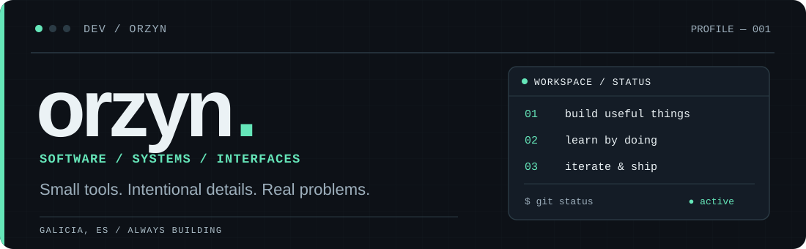

<div align="center">
  <picture>
    <source media="(prefers-color-scheme: dark)" srcset="./assets/hero-dark.svg">
    <source media="(prefers-color-scheme: light)" srcset="./assets/hero-light.svg">
    
  </picture>

  <p>
    <strong>Building useful software, one problem at a time.</strong><br>
    Developer in progress · Galicia, Spain
  </p>

  <p>
    <a href="#about">About</a> ·
    <a href="#workbench">Workbench</a> ·
    <a href="#toolbox">Toolbox</a> ·
    <a href="https://github.com/orzyn?tab=repositories">Repositories</a>
  </p>
</div>

---

<h2 id="about"><code>01.</code> About</h2>

```text
$ whoami
jorge / orzyn

$ cat interests.txt
web development
browser extensions & automation
software with a purpose
thoughtful interfaces & interactions
```

I'm a software development student who likes turning repetitive tasks and everyday problems into simple, practical tools. I enjoy working across the stack, experimenting with interface details, and learning by building.

My approach is straightforward: **solve something real, keep it usable, and improve it with every iteration.**

<h2 id="workbench"><code>02.</code> Workbench</h2>

<table>
  <tr>
    <td width="50%" valign="top">
      <h3>01 / Utility software</h3>
      <p>Browser extensions, desktop utilities, and small automations that remove unnecessary steps.</p>
    </td>
    <td width="50%" valign="top">
      <h3>02 / Web experiences</h3>
      <p>Websites and applications with careful layouts, purposeful motion, and responsive interfaces.</p>
    </td>
  </tr>
  <tr>
    <td width="50%" valign="top">
      <h3>03 / Application development</h3>
      <p>Android, backend, and database projects that help me explore how complete products fit together.</p>
    </td>
    <td width="50%" valign="top">
      <h3>04 / Open-source journey</h3>
      <p>Learning in public, sharing useful work when it's ready, and improving through feedback.</p>
    </td>
  </tr>
</table>

<h2 id="toolbox"><code>03.</code> Toolbox</h2>

<table>
  <tr>
    <td width="24%"><strong>Web</strong></td>
    <td><code>JavaScript</code> <code>HTML</code> <code>CSS</code></td>
  </tr>
  <tr>
    <td><strong>Applications</strong></td>
    <td><code>Java</code> <code>Android</code> <code>Electron</code></td>
  </tr>
  <tr>
    <td><strong>Backend & data</strong></td>
    <td><code>Node.js</code> <code>SQL</code> <code>SQLite</code></td>
  </tr>
  <tr>
    <td><strong>Workflow</strong></td>
    <td><code>Git</code> <code>GitHub</code> <code>PowerShell</code></td>
  </tr>
</table>

<sub>Technologies I use, study, or experiment with — not a list of expertise claims.</sub>

<h2><code>04.</code> Working principles</h2>

> **Useful beats flashy.** Details matter, but the purpose comes first.
>
> **Build, test, iterate.** Small improvements compound.
>
> **Stay curious.** Every project is an opportunity to learn something new.

---

<div align="center">
  <p><strong>Interested in what I'm building?</strong></p>
  <p>
    <a href="https://github.com/orzyn?tab=repositories">Explore my repositories</a>
    &nbsp;·&nbsp;
    <a href="https://github.com/orzyn">Find me on GitHub</a>
  </p>
  <sub>orzyn · Made in Galicia · Built with curiosity</sub>
</div>
